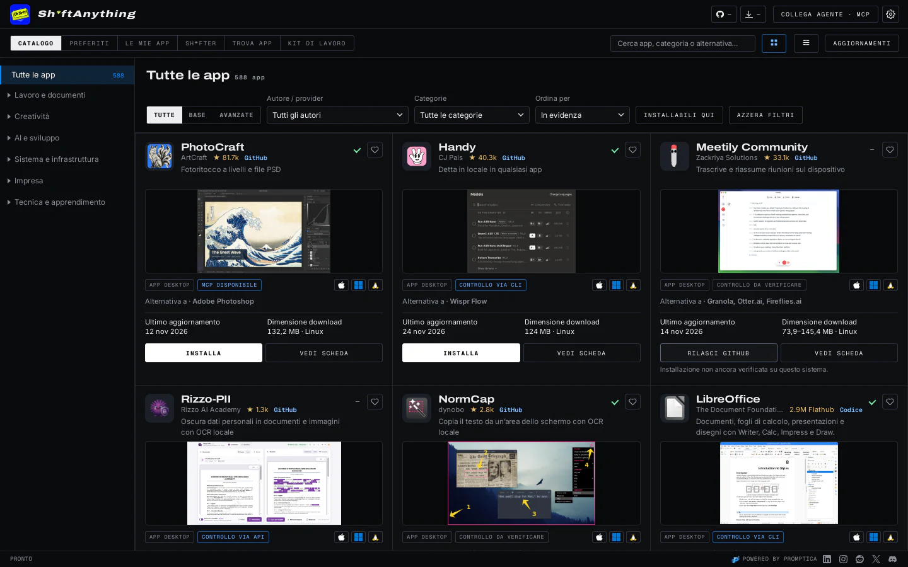
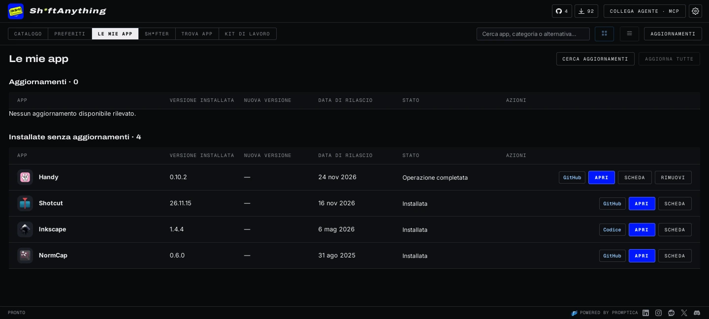
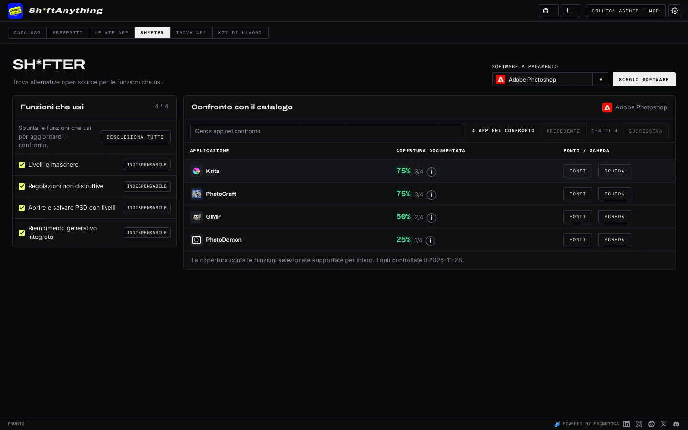
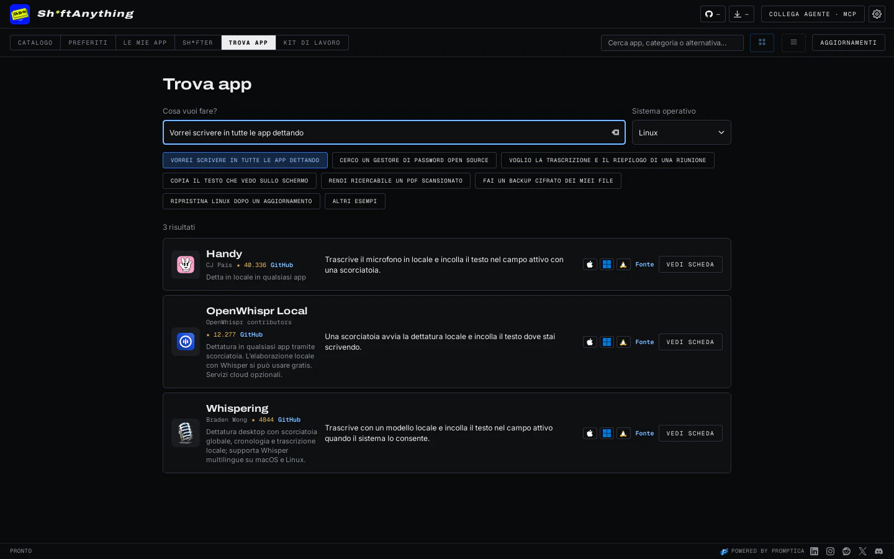

<p align="center">
  
</p>

<h1 align="center">Sh*ftAnything</h1>

<p align="center">Trova, confronta, installa e aggiorna app gratuite e open source da un solo launcher.</p>

<p align="center">
  <a href="https://promptica.it/shiftanything"><strong>Scarica la beta</strong></a> ·
  <a href="https://github.com/pampa-stack/shiftanything/releases/latest">Release su GitHub</a> ·
  <a href="https://discord.gg/Xrg2kksz2m">Discord</a> ·
  <a href="README.md">English</a>
</p>

<!-- Screenshots captured from the published Sh*ftAnything 0.20.9 Linux desktop package. -->


## Scarica

| Piattaforma | Pacchetto |
| --- | --- |
| Mac con chip Apple serie M | `.dmg` notarizzato |
| Ubuntu 24.04 (x64) | `.deb` |
| Linux (x64) | `.tar.gz` portatile. Le dipendenze sono nel README incluso. |

Scarica il pacchetto dalla [landing di Sh*ftAnything](https://promptica.it/shiftanything). Trovi checksum e disponibilità per piattaforma nell’[ultima release](https://github.com/pampa-stack/shiftanything/releases/latest).

## Cosa puoi fare

- **Catalogo** — Esplora app desktop e dashboard, filtra per categoria o autore e salva i preferiti. Attiva **Installabili qui** per vedere i pacchetti verificati per il tuo sistema.
- **Le mie app** — Apri, aggiorna o rimuovi le app supportate. Segui l’avanzamento dei download e controlla quali app hanno aggiornamenti.
- **SH\*FTER** — Seleziona le funzioni che usi in un software a pagamento. Confronta le alternative open source e apri le fonti che giustificano il punteggio.
- **Trova app** — Parti da quello che vuoi fare, ad esempio «Voglio scrivere in ogni app dettando». La ricerca usa in locale un insieme di attività e sinonimi curati.
- **Kit di lavoro** — Scopri gli strumenti per ogni fase di un mestiere, dal ritocco alla prototipazione, e scegli quali installare.
- **Collega agente** — Collega un coding agent con MCP locale. La configurazione usa Python tramite `uv` e le azioni di gestione richiedono conferma nel launcher.

### Gestisci le app installate



### Confronta le funzioni con SH\*FTER



### Descrivi quello che vuoi fare



### Parti da un Kit di lavoro


## Contribuisci

[Proponi un’app](https://github.com/pampa-stack/shiftanything/issues/new) indicando repository ufficiale, licenza e pagina di download. Per un bug, includi versione del launcher, sistema operativo, architettura e passaggi per riprodurlo. Puoi anche unirti al [Discord di Promptica](https://discord.gg/Xrg2kksz2m).

## Compila dal sorgente

L’app desktop usa Tauri con HTML, CSS e JavaScript. Il motore Rust deriva da ArtCraft Launcher 0.20.3. Segui la [guida di sviluppo](apps/shiftanything-tauri-proof/README.md), poi compila con:

```sh
cargo build -p shiftanything-tauri-proof --locked
```

[Pacchetti per macOS](packaging/macos/README.md) · [Pubblicazione della beta](packaging/RELEASE.md) · [Verifiche di sicurezza della release](docs/verification/pro-371-release-security/README.md)

## Crediti e licenze

Il codice del launcher è distribuito con licenza [MIT](LICENSE-MIT) o [Apache 2.0](LICENSE-APACHE). Il motore ArtCraft originale è copyright © 2026 ArtCraft Team e contributori. I crediti sono in [ATTRIBUTION.md](ATTRIBUTION.md), [NOTICE](NOTICE) e nel [README originale archiviato](docs/upstream/README-artcraft-0.20.3.md). Sh*ftAnything è un marchio Promptica. Marchi e contenuti di terze parti appartengono ai rispettivi titolari.
