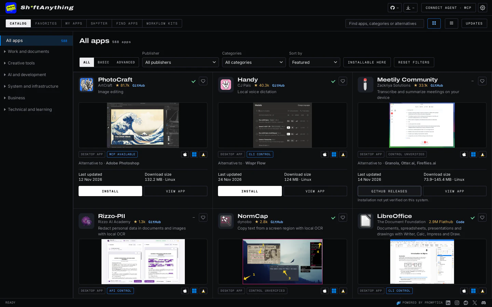
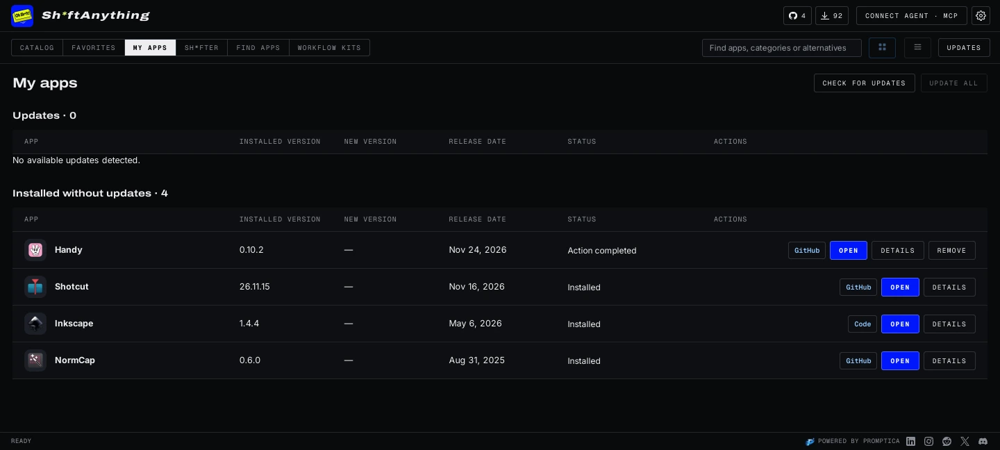
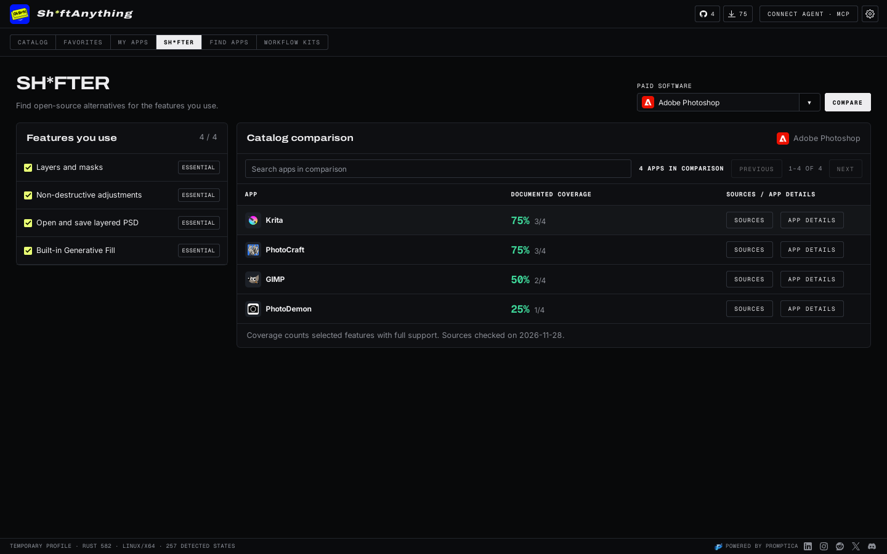
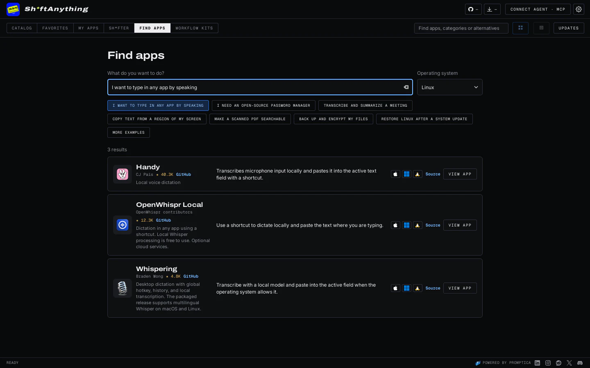
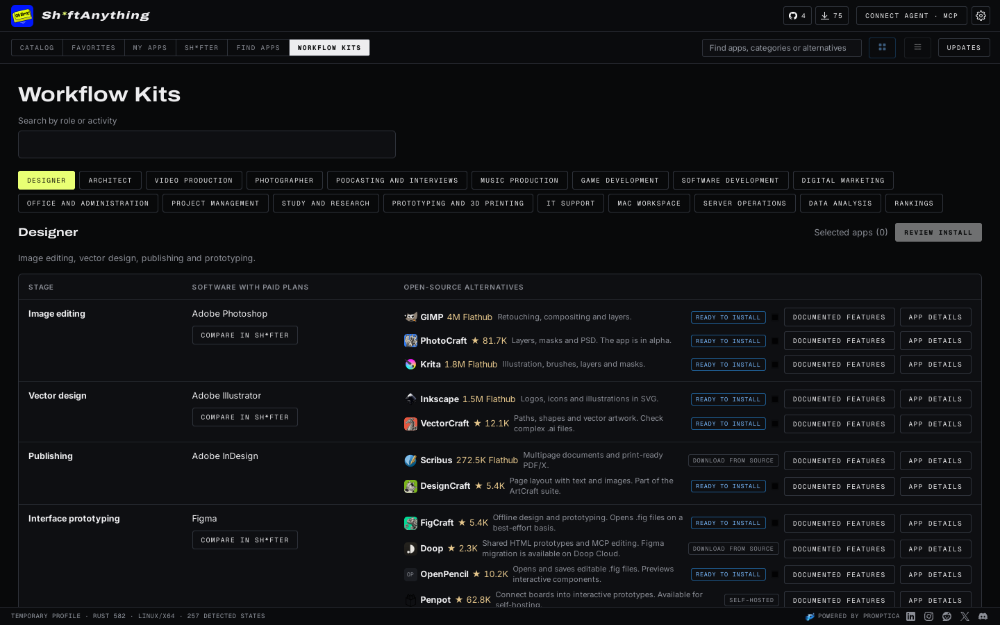

<p align="center">
  
</p>

<h1 align="center">Sh*ftAnything</h1>

<p align="center">Find, compare, install and update free, open-source apps from one desktop launcher.</p>

<p align="center">
  <a href="https://promptica.it/shiftanything"><strong>Download the beta</strong></a> ·
  <a href="https://github.com/pampa-stack/shiftanything/releases/latest">GitHub releases</a> ·
  <a href="https://discord.gg/Xrg2kksz2m">Discord</a> ·
  <a href="README.it.md">Italiano</a>
</p>

<!-- Screenshots captured from the published Sh*ftAnything 0.20.9 Linux desktop package. -->


## Download

| Platform | Package |
| --- | --- |
| Mac with Apple silicon (M-series) | Notarized `.dmg` |
| Ubuntu 24.04 (x64) | `.deb` |
| Linux (x64) | Portable `.tar.gz`. See the included README for desktop dependencies. |

Get the packages from the [download page](https://promptica.it/shiftanything) or check the [latest release](https://github.com/pampa-stack/shiftanything/releases/latest) for checksums and current platform availability.

## What you can do

- **Catalog** — Browse desktop apps and dashboards, filter by category or publisher, and save favorites. Turn on **Installable here** to see verified packages for your system.
- **My Apps** — Open, update or remove supported apps. Follow download progress and see which apps have updates.
- **SH\*FTER** — Pick the features you use in paid software. Compare open-source alternatives side by side and open the sources behind each score.
- **Find Apps** — Start with a task in your own words, such as “I want to type in any app by speaking.” Matching runs locally using a curated set of tasks and aliases.
- **Workflow Kits** — See what a role needs, from image editing to prototyping, and review which apps to install for each stage.
- **Connect Agent** — Connect a coding agent through local MCP. Setup uses Python via `uv`, and management actions require approval in the launcher.

### Manage installed apps



### Compare features with SH\*FTER



### Find an app by describing what you need



### Start with a Workflow Kit



## Contribute

[Suggest an app](https://github.com/pampa-stack/shiftanything/issues/new) with its upstream repository, license and download page. For a bug, include your launcher version, operating system and architecture, and the steps that reproduce it. You can also join the [Promptica Discord](https://discord.gg/Xrg2kksz2m).

## Build from source

The desktop app uses Tauri with HTML, CSS and JavaScript, backed by a Rust engine derived from ArtCraft Launcher 0.20.3. Follow the [desktop development guide](apps/shiftanything-tauri-proof/README.md), then build with:

```sh
cargo build -p shiftanything-tauri-proof --locked
```

[macOS packaging](packaging/macos/README.md) · [Beta release process](packaging/RELEASE.md) · [Release security checks](docs/verification/pro-371-release-security/README.md)

## Credits and licenses

The launcher code is dual-licensed under [MIT](LICENSE-MIT) or [Apache 2.0](LICENSE-APACHE). The original ArtCraft engine is copyright © 2026 ArtCraft Team and contributors. See [ATTRIBUTION.md](ATTRIBUTION.md), [NOTICE](NOTICE) and the [archived upstream README](docs/upstream/README-artcraft-0.20.3.md) for credits. Sh*ftAnything is a Promptica mark. Third-party marks and media belong to their respective holders.
