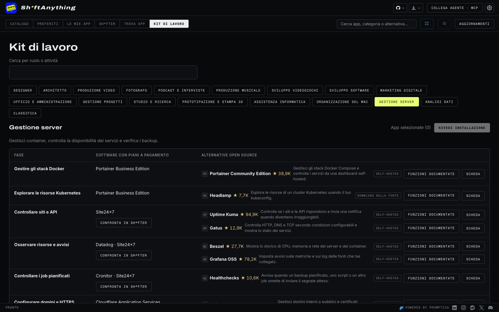
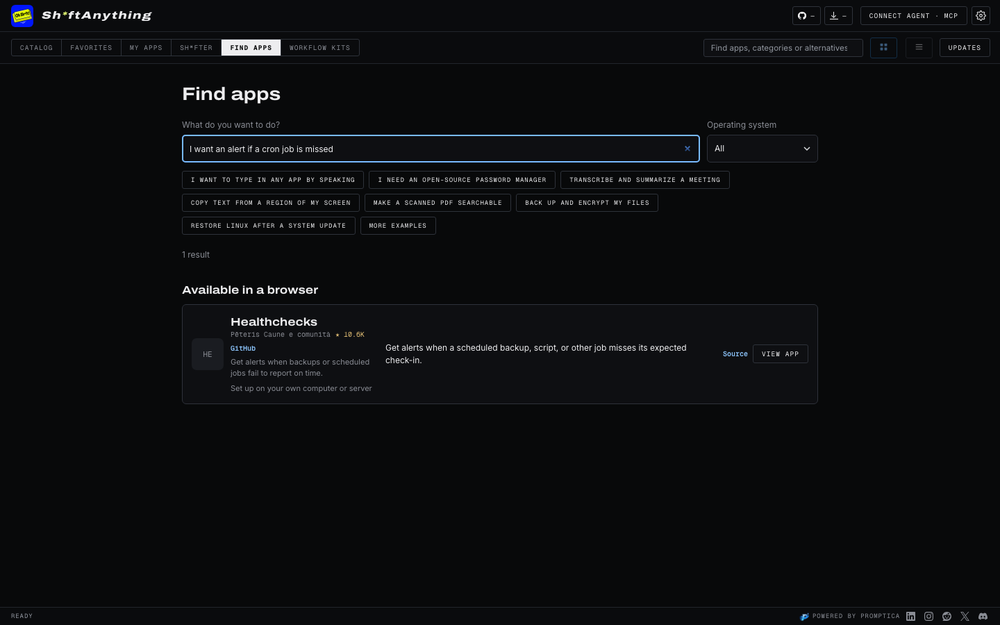

# Kit, Trova app e SH*FTER per server e analisi dati

Verifica del 28 novembre 2026 su 582 schede. I kit **Gestione server** e **Analisi dati** aggiungono 13 attività, per un totale di 17 kit e 110 attività. Ogni attività aggiunta indica software usato sul mercato, alternative presenti nel catalogo e la fonte della funzione descritta. Gli otto nuovi intenti bilingui di Trova app portano il totale a 67.

SH*FTER include ora Power BI e Site24x7, per un totale di 21 profili. Il motore valuta l'intero catalogo. L'interfaccia mostra i risultati con copertura positiva sulle funzionalità selezionate. Il punteggio si applica a quelle funzionalità, con i limiti documentati dalle fonti del profilo.

- Cargo: 159 test core passati, uno ignorato. 21 test Tauri passati. Build debug macOS arm64 completata.
- MCP reale via stdio: 582 schede, 21 profili, filtri, selezione manuale, risposte e rifiuti del bridge con IPC temporaneo.
- Contratto Rust e MCP: 22.227 combinazioni di funzionalità e requisiti obbligatori con lo stesso risultato.
- Chromium a 1440×900 in italiano e inglese: i 67 esempi di ricerca, i 21 profili, i 17 kit e tutte le rispettive attività. Il test usa i risultati calcolati da Rust per SH*FTER e simula il bridge Tauri, i media remoti e le operazioni native.

